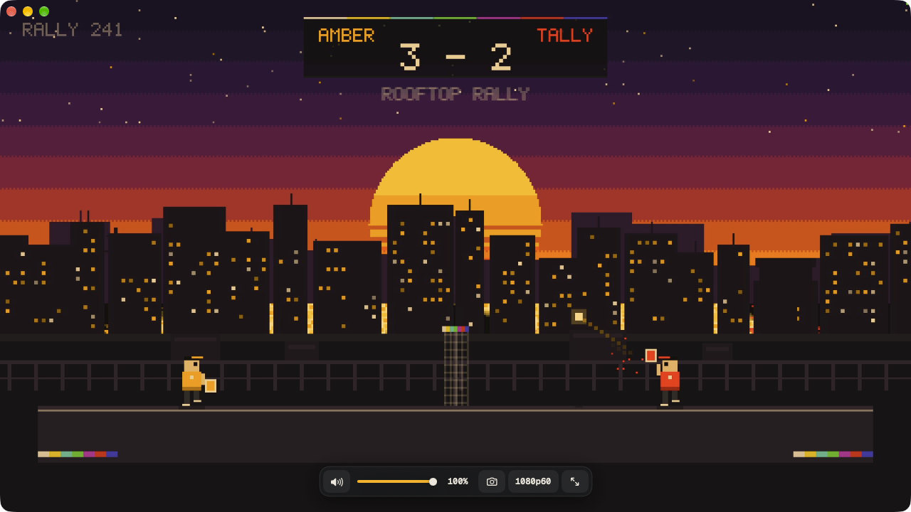
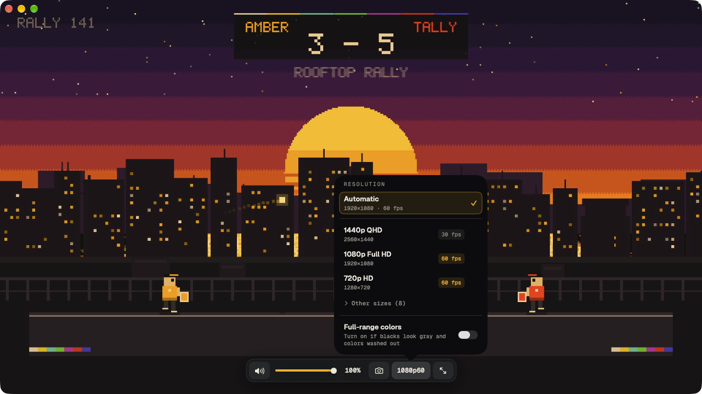
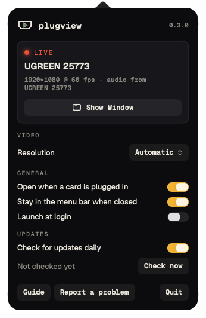
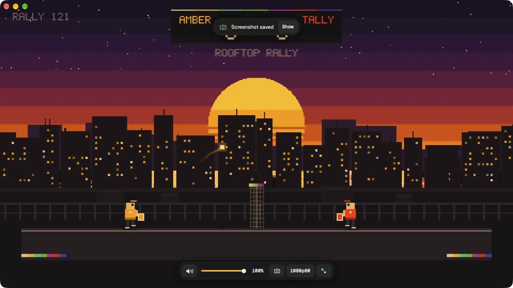

<picture>
  <source media="(prefers-color-scheme: dark)" srcset="https://raw.githubusercontent.com/plugview/plugview/main/docs/images/banner-dark.png">
  
</picture>

[](https://github.com/plugview/plugview/actions/workflows/ci.yml)
[](https://github.com/plugview/plugview/releases/latest)
[](LICENSE)
[](https://plugview.app)

Plug in a capture card, open plugview (or type `plugview`), play.

A tiny, open-source macOS app and command that shows your HDMI capture device (Nintendo Switch, PlayStation,
Xbox, Steam Deck, camera, …) in a resizable window with sound, as fast as the Mac can draw it. No scenes, no
sources, no streaming setup.

<p align="center"></p>
<p align="center"><sub>A real capture through a UGREEN 25773. The game is Rooftop Rally, our own pixel-art test scene.</sub></p>

## Why

I often want to play while something runs on my Mac, and I have one screen. I wanted to plug the console in and
see it in a window on the same computer I work on, like any other app. The usual answer is OBS, which is a full
broadcast studio: scenes, sources, audio monitoring. Too much for something this simple. So plugview does one
thing: it opens the capture card and plays, with sound, at the lowest latency the Mac can draw.

## Features

- **Low latency.** Frames go straight from the capture driver to the GPU compositor. plugview never copies a
  frame. It picks the card's native pixel format, keeps the frame rate locked, and uses a 2.7 ms playback buffer.
  [Measured numbers](docs/PERFORMANCE.md).
- **Smooth by default.** Prefers the highest frame rate: 1080p60 beats 4K30. Or pick any mode the card offers;
  the choice is remembered per card.
- **Sound included.** Finds the card's own audio input and plays it on your current output. Never your microphone.
- **Plug and play.** Start it before or after plugging in. Unplug and replug and it re-attaches; it also
  recovers after the Mac wakes from sleep.
- **Lives in the menu bar.** Plug a card in and plugview opens and plays; close the window and the card is
  released. Launch at login if you like.
- **Screenshots.** Press `S` for a full-resolution PNG of the current frame.
- **Your window.** Actual size, zoom, keep on top, full screen; full-range colors for cards that send gray blacks.
- **Self-check.** `plugview --measure` reports the real frame rate and latency and tells you what to fix.
- **Zero dependencies.** One native binary, Apple frameworks only. Under 2 MB to download.

<table>
  <tr>
    <td width="58%"></td>
    <td rowspan="2" align="center"></td>
  </tr>
  <tr>
    <td></td>
  </tr>
</table>

Guides on the website: [setup](https://plugview.app/guide/), [capture cards that work](https://plugview.app/cards/),
and step by step for [Switch](https://plugview.app/switch-on-mac/), [PlayStation](https://plugview.app/ps5-on-mac/),
[Xbox](https://plugview.app/xbox-on-mac/) and [Steam Deck](https://plugview.app/steam-deck-on-mac/).
How it compares: [plugview vs OBS](https://plugview.app/vs/obs/).

Requires macOS 14 Sonoma or later, on Apple silicon or Intel.

## Install

**The app, with Homebrew** (recommended). It also puts the `plugview` command on your PATH:

```sh
brew install --cask plugview/tap/plugview
```

**Only the command, with Homebrew:**

```sh
brew install plugview/tap/plugview
```

Both install the `plugview` command, so pick one. If both are installed, the command-only package's
`plugview` is the one on your PATH. To switch, `brew uninstall plugview` first.

**The app, downloaded:** get `plugview-macos-app.zip` from
[Releases](https://github.com/plugview/plugview/releases/latest), unzip it, and move `plugview.app` to
Applications.

**Only the command, prebuilt** from [Releases](https://github.com/plugview/plugview/releases/latest):

```sh
curl -fsSL https://github.com/plugview/plugview/releases/latest/download/plugview-macos-universal.tar.gz | tar -xz
sudo install plugview-*/plugview /usr/local/bin/
```

Downloading with `curl` avoids the Gatekeeper prompt. If you downloaded the archive in a browser, run
`xattr -d com.apple.quarantine plugview` once before starting it.

**From source** (needs Xcode 16.4 or later, or its Command Line Tools):

```sh
git clone https://github.com/plugview/plugview.git && cd plugview
make install            # installs to ~/.local/bin; use `sudo make install PREFIX=/usr/local` for all users
make app                # builds .build/dist/plugview.app
```

### Not notarized yet

plugview is not signed with an Apple Developer ID yet. Until it is:

- The first time you open the app, macOS says it cannot verify it. Open **System Settings › Privacy &
  Security**, scroll down, and click **Open Anyway**. This is needed once per install or update.
- Until you do, the `plugview` command that comes with the app is stopped by macOS too (the shell prints
  `killed` or nothing, exit code 137). Open the app once and approve it; after that the command works.
- After each update macOS asks for camera and microphone access again, because it cannot tell the new build
  from a different app.

Signing and notarization are planned before any paid features.

## Use

Open **plugview** from Applications, Launchpad, or Spotlight. It waits for a capture card, plays the one you
plug in, and lets you pick when several are connected. From a terminal:

```sh
plugview                 # first USB capture device, with its audio
plugview -f              # start in full screen
plugview --list          # show detected video and audio devices
plugview --measure       # measure frame rate and latency, with advice
plugview -d "Cam Link" -a "Cam Link"   # pick devices by name
plugview --no-audio      # video only
plugview -v 50           # start at 50 % volume
plugview --mode 1280x720@60            # a specific mode (plugview --list shows them)
```

| Key | Action |
| --- | --- |
| `F` / `⌃⌘F` | Toggle full screen |
| `Esc` | Leave full screen |
| `M` | Mute / unmute |
| `S` | Save a screenshot to `~/Pictures/plugview` |
| `⌘0` / `⌘+` / `⌘-` | Actual size (one video pixel per screen pixel) / bigger / smaller |
| `⌥⌘T` | Keep the window on top of other apps |
| `↑` `↓` | Volume ±10 % |
| `⌘M` | Minimize |
| `Q` / `⌘Q` | Quit |

The video fills the window with no title bar. Move the mouse to show the window buttons and a controls bar
(mute, volume, resolution, full screen, and the capture device when more than one is connected); they fade out
when the mouse rests. Scroll over the bar to change the volume. The camera button saves a screenshot. The resolution
panel also has **Full-range colors**: turn it on if blacks look gray and colors washed out (some cards label their
video's color range wrong); screenshots get the same fix. Drag the video to move the window. Resize it by
dragging an edge; it keeps the video's aspect ratio and remembers its size and position.

### Menu bar

Opened as an app, plugview also puts its mark in the menu bar: empty while it waits, with the play triangle once a
card has signal, filled while it plays. Click it for the status, the resolution and frame rate (Automatic picks
the smoothest; your choice is remembered per card), and the settings:

- **Open when a card is plugged in**: with plugview in the menu bar, plugging in a card opens the window and plays.
- **Stay in the menu bar when closed**: closing the window releases the card (the camera light goes off) and
  plugview keeps waiting in the menu bar. Turn it off to quit when the window closes, as before.
- **Launch at login**, and **Check for updates daily** (asks GitHub for the latest release; see
  [SECURITY.md](SECURITY.md)).

Typed in a terminal, plugview has no menu bar icon, always starts in the best mode, and quits when its window
closes, exactly as before.

## First run: permissions

macOS asks once for **Camera** (video) and **Microphone** (the card's audio) access. To macOS a capture card
is a camera. Opened as an app, plugview explains this first and asks for itself. Typed in a terminal, the
permission belongs to your terminal app (Terminal, iTerm, Warp, …). If you said no, re-enable it in
**System Settings › Privacy & Security › Camera / Microphone**.

## Lowest latency checklist

`plugview --measure` checks most of these for you:

1. Plug the card straight into a **USB 3** port on the Mac, not a hub.
2. Use **full screen** (`-f` or `F`).
3. Play sound on the **Mac speakers or wired headphones**. Bluetooth adds 100–300 ms.
4. Use a display refresh rate that is a **multiple of the game's frame rate** (60 or 120 Hz for 60 fps games).
   At 100 Hz, frames are shown for uneven times.

## Troubleshooting

- **No sound:** run `plugview --list` and pass the card's audio input with `--audio <name>`. plugview does
  not guess when several USB audio inputs are connected.
- **Choppy picture or low fps:** run `plugview --measure`. It shows the frame rate the card really delivers.
- **Washed-out or too-dark colors (Switch):** set *System Settings › TV Output › RGB Range* on the console to
  match your card (try *Limited* first, then *Full*).
- **"cannot be added to the capture session":** another app (OBS, Zoom, …) is using the card. Close it.

Found a bug? [Open an issue](https://github.com/plugview/plugview/issues/new/choose) and include the output
of `plugview --list` and `plugview --measure`.

## Contributing

Pull requests are welcome. See [CONTRIBUTING.md](CONTRIBUTING.md) for the project layout, the checks every
change must pass, and how releases are made. Changes are listed in [CHANGELOG.md](CHANGELOG.md).

## License

[MIT](LICENSE) © Mauricio León. The bundled Geist and Geist Mono fonts are under the
[SIL Open Font License 1.1](Sources/PlugviewUI/Fonts/OFL.txt).
